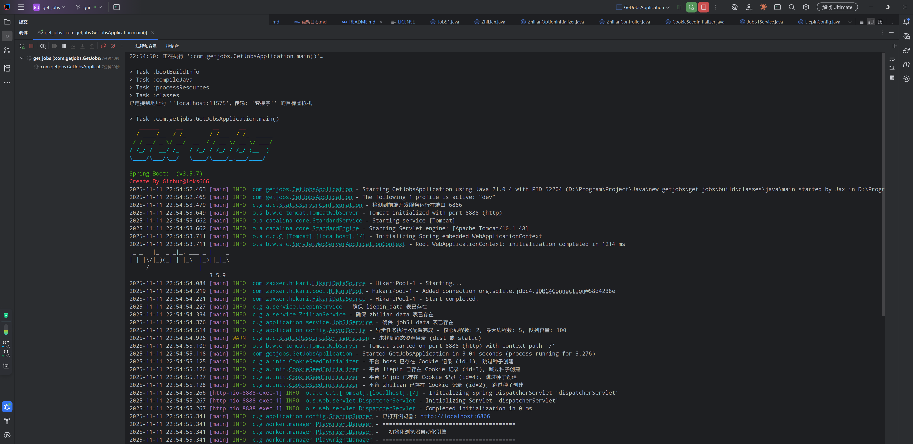
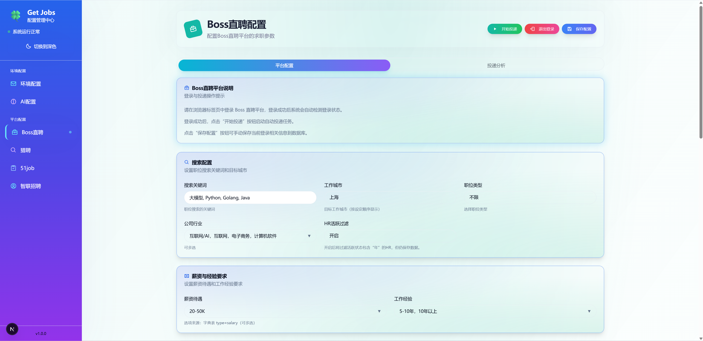
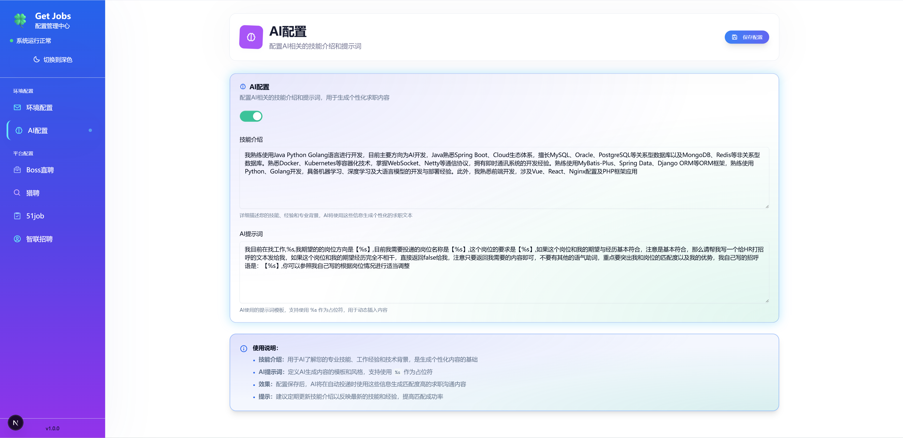

<h1 align="center">🍀 Get Jobs Personal【工作无忧 · 个人分支】</h1>

<div align="center">


**一个跑在本地、带 Web 管理界面的自动化求职工具。**

基于 [get_jobs](https://github.com/loks666/get_jobs) 的个人可用分支，重点打磨 **Boss 直聘** 的 AI 沟通、简历与投递流程，同时保留猎聘等平台的原有能力。

</div>

---

## 📖 这是什么项目

**Get Jobs Personal** 是一个面向个人求职者的本地自动化投递与沟通辅助系统。它把重复、机械的「搜岗位 → 看 JD → 打招呼 → 跟进」流程交给程序，把时间留给面试准备。

系统由三部分组成：

1. **Spring Boot 后端**：任务调度、配置管理、SQLite 数据持久化、REST + SSE 接口，同时直接托管已经构建好的管理页面。
2. **Next.js 管理端**：配置岗位条件、扫码登录、查看运行日志、查看岗位分析与聊天工作区。
3. **Playwright / Patchright 执行层**：驱动真实浏览器完成登录、岗位抓取、打招呼、聊天记录读取等操作。

所有数据都保存在本机：SQLite 数据库、Cookie、浏览器用户目录、简历文件。项目不上传任何数据，也不提供云端服务。

> 本仓库是上游 `loks666/get_jobs` 的个人分支快照，**不是上游官方仓库**。来源、基准提交与许可声明见 [SOURCE-NOTICE.md](SOURCE-NOTICE.md)。

---

## ✨ 相对上游的主要改动

本分支的 `main` 来自作者本机可用的工作副本，在上游 `8f5c485` 基础上做了以下工作（完整清单见 [SOURCE-NOTICE.md](SOURCE-NOTICE.md)）：

### Boss 直聘

- **四类资料管理**：工作经历 / 项目经历 / 教育经历 / 技能，JSON 兼容存储与增删改查，作为 AI 生成沟通内容的上下文。
- **聊天工作区**：聊天记录只读同步、AI 决策展示、自动回复硬门闸，避免误发。
- **跟进流程**：跟进候选人原子 claim，同一轮次只发送一次；身份未绑定时 fail-closed。
- **简历能力**：简历文本草稿、显式批准后生效；图片简历与 PDF 简历支持页面上传、本地校验与存储。
- **投递执行护栏**：`BossExecutionGuard`、`delivery/` 投递任务、运行记录与停止控制。
- **行业目录**：内置官方行业目录 `boss/industry-catalog.json`（15 大类 / 134 个细分行业），用于行业筛选。
- **AI 接口兼容**：同时支持 `chat/completions` 与 `responses` 两种端点；模型名支持 `模型:effort` 后缀，自动映射 `reasoning_effort` / `reasoning.effort`，遇到 reasoning 参数不兼容时自动回退到 Responses API。

### 其他

- **统一前端外壳**：共享 Sidebar / PageHeader / ContentArea，重做 Boss 页面与聊天组件。
- **猎聘 / 51job / 智联**：仅统一 UI 样式，字段、接口、序列化与后端逻辑保持上游实现。
- **端口调整**：`server.port` 由 `9527` 改为 `8888`（避免与本地代理软件冲突）。
- **发布脱敏**：移除脚本与测试中的个人绝对路径，简历文件与构建产物不入库。

---

## 🌟 功能一览

- **🖥️ Web 管理界面**：一个 jar 同时提供 API 与管理页面，浏览器打开 `http://localhost:8888` 即可使用。
- **🤖 AI 智能沟通**：接入任意兼容 OpenAI 接口的大模型，结合个人经历与岗位 JD 生成打招呼语，并对聊天给出回复建议。
- **📷 图片简历**：打招呼后自动附送图片简历，减少等待 HR 索要的中间环节。
- **📄 PDF 简历**：支持上传、校验、存储与批准，作为后续发送能力的基础。
- **🛡️ 精准过滤**：自动跳过不活跃 HR、猎头岗位、薪资不达标岗位，支持企业黑名单自学习。
- **🔁 可选重复沟通**：可控制是否向已沟通的 Boss 再次发送消息，默认关闭，消息内容可在页面编辑。
- **📊 岗位分析**：投递统计、岗位列表与筛选结果可视化。
- **📢 企业微信通知**：通过群机器人 Webhook 实时推送投递进展。
- **🔄 持久登录**：本地保存 Cookie 与浏览器状态，减少重复扫码。

---

## 🧱 系统架构

```text
┌──────────────────────────────────────────────────────────┐
│ 管理端（Next.js 16 + React 19 + Tailwind + Radix UI）      │
│  - 平台配置 / 扫码登录 / 投递监控 / 岗位分析 / 聊天工作区   │
└───────────────────────────┬──────────────────────────────┘
                            │ HTTP / SSE（默认 8888）
┌───────────────────────────▼──────────────────────────────┐
│ 后端（Spring Boot 3.5 + MyBatis-Plus + SQLite）            │
│  - REST / SSE 接口、配置与任务调度、数据持久化              │
│  - 静态资源托管：jar 内 dist/ 直接提供管理页面              │
│  - AI 服务：chat/completions 与 responses 双端点            │
└───────────────────────────┬──────────────────────────────┘
                            │ 内部模块调用
┌───────────────────────────▼──────────────────────────────┐
│ 执行层（Java 21 + Playwright Java + Patchright driver）    │
│  - 登录、岗位抓取、打招呼、聊天记录读取、投递执行           │
│  - 平台模块：boss / liepin / job51 / zhilian               │
└──────────────────────────────────────────────────────────┘
```

**技术栈**

| 层 | 技术 |
| :--- | :--- |
| 后端 | Java 21、Spring Boot 3.5.16、MyBatis-Plus 3.5.9 |
| 浏览器自动化 | Playwright Java 1.62 + Patchright 1.62（反检测 driver） |
| 数据 | SQLite（`db/getjobs.db`） |
| 前端 | Next.js 16.3、React 19、TypeScript、Tailwind CSS、Radix UI、Chart.js |
| 构建 | Gradle Wrapper 9.x、pnpm（前端） |

---

## 🎯 平台支持

| 平台 | 状态 | 说明 |
| :--- | :---: | :--- |
| **Boss 直聘** | 🟢 主要维护 | AI 打招呼、图片/PDF 简历、聊天工作区、投递护栏、行业筛选；每日打招呼上限以平台提示为准（README 记录约 150 次） |
| **猎聘** | 🟢 可用 | 扫码登录；建议先在猎聘 App 设置打招呼语；主动私信有频控 |
| **51job** | ⚪ 停止维护 | 投递与搜索限制较多，现存功能不保证可用 |
| **智联招聘** | ⚪ 停止维护 | 需预先指定默认投递简历，现存功能不保证可用 |
| **拉勾** | ⚪ 暂停维护 | 使用人数少，暂无维护计划 |

> 建议：把本项目当作 PC 端的**筛选与兜底工具**。真正心仪的岗位，在 HR 回复后回到手机 App 深入沟通。

---

## 🚀 快速开始

### 1. 环境要求

| 组件 | 要求 |
| :--- | :--- |
| 操作系统 | Windows 10/11、macOS 或 Linux（需要桌面图形环境） |
| JDK | **21**（推荐 Temurin 21） |
| Node.js | 用于前端构建与 Playwright driver（建议 18+，并带 npm） |
| 浏览器 | 本地 Chrome / Chromium；测试与自动化会使用 Playwright 内核 |
| 网络 | 关闭境外代理；不要部署在云服务器（机房 IP 会被平台风控） |

### 2. 克隆本仓库

```bash
git clone https://github.com/James0027/get-jobs-personal.git
cd get-jobs-personal
```

### 3. 准备数据库（必做）

仓库不包含数据库文件（避免泄露个人配置与登录态），需要自行放一份空库：

1. 从上游 Releases 下载 `getjobs.db.template`；
2. 重命名为 `getjobs.db`；
3. 放到项目根目录 `db/` 下，最终路径为 `db/getjobs.db`。

首次启动且平台配置为空时，程序会从 `src/main/resources/defaults/page-config.json` 载入默认配置（搜索条件、AI 提示词、Boss 黑名单等）。默认值是维护者的页面快照，**投递前请改成自己的真实信息**。初始化只执行一次，不会覆盖已有配置。

> ⚠️ 老用户升级时不要覆盖已有的 `db/getjobs.db`。

### 4. 启动

```bash
# Windows（推荐，自动探测 JDK 21 与 node）
.\启动.cmd

# 或者直接用 Gradle
.\gradlew.bat bootRun        # Windows
./gradlew bootRun            # Linux / macOS
```

首次启动会自动：

- 下载并装配 Patchright driver（`installPatchrightDriver`）；
- 构建管理页面到 `src/main/resources/dist`（已有产物则跳过）；
- 启动后端并打开 `http://localhost:8888`。

Windows 下停止服务可双击 `停止.cmd`。也可以先打包再运行：

```bash
./gradlew bootJar
java -jar build/libs/get_jobs-2.0.1.jar
```

### 5. 配置 AI（可选）

在管理页「AI 配置」或项目根目录 `.env` 中填写：

```dotenv
# 企业微信群机器人 Webhook（可选，用于投递通知）
HOOK_URL=https://qyapi.weixin.qq.com/cgi-bin/webhook/send?key=your_key_here

# 兼容 OpenAI 接口的地址
BASE_URL=https://api.openai.com

# API Key
API_KEY=sk-xxxxxxxxxxxxxxxx

# 模型名；支持 "模型:effort" 形式，如 gpt-5-mini:high
MODEL=gpt-5-nano
```

说明：

- `BASE_URL` 只要能兼容 OpenAI 接口即可，官方地址或自建中转都行，项目不绑定任何服务商。
- 端点会自动补全：`BASE_URL` 已带 `/v1` 时只拼 `/chat/completions`，否则拼 `/v1/chat/completions`；Responses API 同理。
- `MODEL` 写成 `模型名:effort`（如 `gpt-5-mini:high`）会同时设置 reasoning effort；若服务端不接受该参数，会自动改用 Responses API 重试。
- AI 产生的费用由所选服务商收取，与项目本身无关。

### 6. 准备简历

- **图片简历**：管理页 Boss 配置中上传图片（或放入旧版约定位置），并开启发送图片简历开关。
- **PDF 简历**：管理页上传后由后端做本地校验与存储；当前版本仅完成存储与批准，**真实 PDF 发送尚未实现**（见「已知边界」）。

---

## ⚙️ 关键配置

- **岗位条件**：城市、关键词、薪资区间、经验/学历、行业（内置 15 大类 / 134 细分）。
- **Boss 投递行为**：
  - 「向已沟通 Boss 再次发送消息」默认关闭；开启后从页面维护的消息列表中随机选一条发送，空行忽略，全部为空则跳过。
  - 修改后保存配置，下次启动投递时生效。
- **黑名单**：检测到「不合适」「已招满」等回复时自动将企业加入黑名单，也可手动增删。
- **Cookie**：登录成功后保存在本机；失效时在管理页重新扫码即可。

---

## 🗂️ 目录结构

```text
.
├── src/main/java/com/getjobs/
│   ├── application/          # 控制器、配置、实体、Mapper、服务、初始化
│   │   ├── chat/             # Boss 聊天、AI 工作流、跟进、投递决策
│   │   ├── controller/       # REST / SSE 接口
│   │   └── service/          # AI、Boss、猎聘、51job、智联、简历服务
│   └── worker/               # Playwright 执行层
│       ├── boss/             # Boss 自动化与 delivery 投递任务
│       ├── liepin/           # 猎聘
│       ├── job51/            # 51job
│       ├── zhilian/          # 智联
│       └── manager/          # PlaywrightManager（浏览器生命周期）
├── src/main/resources/
│   ├── defaults/             # 首次启动默认配置
│   ├── boss/                 # 行业目录
│   ├── chat/                 # AI 请求/决策 JSON Schema
│   └── application.yaml      # 端口 8888、SQLite 数据源等
├── src/test/java/            # 单元测试 + DOM 测试
├── front/                    # Next.js 管理端
├── docs/                     # VitePress 文档站
├── doc/                      # 上游文档与截图
├── 启动.cmd / 停止.cmd       # Windows 快捷入口
└── start-local.ps1           # PowerShell 启动脚本
```

---

## 🧪 开发与测试

```bash
# 单元测试（不会隐式下载浏览器）
./gradlew test

# DOM 测试（需要已安装 Playwright 内核或设置 BOSS_TEST_CHROME）
./gradlew domTest

# 全量测试（单元 + DOM，要求所有测试执行且不得跳过）
./gradlew fullTest

# 安装 Patchright driver
./gradlew installPatchrightDriver

# 重新构建管理页面（默认已存在则跳过）
./gradlew buildFrontend -PrebuildFrontend

# 打包
./gradlew bootJar
```

前端独立开发：

```bash
cd front
pnpm install
pnpm dev
```

> `front/server.config.js` 中的 `6866` 仅用于前端独立开发；正常使用时管理页面由后端 jar 内的 `dist/` 提供，只需要 `8888`。

---

## ⚠️ 已知边界

以下能力尚未完成，代码中会明确阻断而不是静默降级：

- **PDF 简历真实发送**：决策为 PDF 时返回 `blocked/PDF_SEND_NOT_IMPLEMENTED`，不会自动降级发送图片。
- **真实聊天 DOM 验收**：目前仅有本地/Mock DOM 用例（`BOSS_CHAT_DOM_TEST=true`），尚未对线上真实页面做完整验收。
- **Boss 实习届别取值**：未取得官方证据前不写入猜测值。
- **自动回复与跟进**：默认关闭；真实会话身份未绑定时 fail-closed（`IDENTITY_NOT_BOUND`）。
- **平台维护范围**：仅 Boss 与猎聘处于维护状态，51job / 智联 / 拉勾不再保证可用。

---

## 🔐 数据与隐私

- 配置、Cookie、投递记录、聊天记录均保存在本地 `db/getjobs.db` 与浏览器用户目录。
- 简历文件、数据库、日志、构建产物均已被 `.gitignore` 排除，不进入仓库。
- 请不要把 `API_KEY`、`HOOK_URL`、Cookie、数据库或简历截图提交到 Git 或公开分享。
- 建议定期备份 `db/getjobs.db`，升级代码时保留原数据库。

---

## 📚 文档

- [文档站首页](docs/index.md)
- [项目介绍与架构](docs/guide/introduction.md)
- [快速开始](docs/guide/quick-start.md)
- [配置详解](docs/guide/config.md)
- [AI 与消息推送](docs/guide/ai-and-push.md)
- [常见问题](docs/guide/faq.md)
- [界面截图](docs/guide/screenshots.md)

## 📸 界面预览






---

## 📄 许可与来源

- 本项目沿用上游许可：**PolyForm Noncommercial License 1.0.0**，仅限非商业使用；再分发须保留 [LICENSE](LICENSE) 与 Required Notice。
- 上游项目：[loks666/get_jobs](https://github.com/loks666/get_jobs)
- Copyright (c) 2024-2026 GET JOBS (https://github.com/loks666/get_jobs)
- 本分支与本仓库的详细来源、基准提交和改动记录见 [SOURCE-NOTICE.md](SOURCE-NOTICE.md)。

## ⚠️ 免责声明

本项目仅供个人学习、技术研究与求职辅助使用。请遵守各招聘平台的用户协议与当地法律法规，合理控制投递频率。因使用本项目导致的账号限制、数据丢失或其他后果由使用者自行承担。
